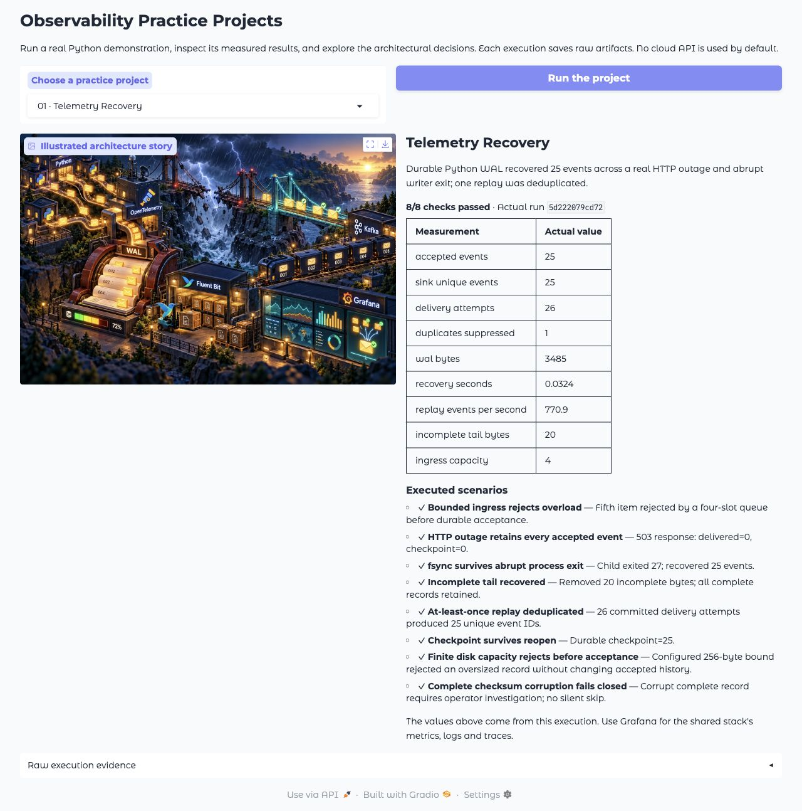
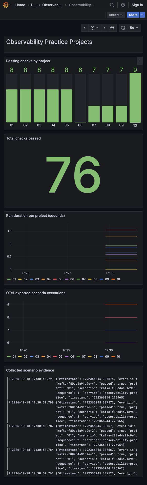

# Observability Practice Projects

Ten hands-on Python projects for understanding how observability behaves during failures. Build durable collection, validate telemetry, control cardinality, protect shared resources, investigate performance, and measure the trade-offs.

**Python · Fluent Bit · OpenTelemetry · Grafana · Prometheus · Loki · Tempo · Kafka**



Each project includes working code, an illustrated architecture story, a screenshot of its actual execution, scenario checks, capacity calculations, and a README explaining the architectural thought process. The decision records explain the design tradeoffs and operational boundaries.

## Choose a project

| Project | Build and investigate | Start here |
| --- | --- | --- |
| 01 · Telemetry Recovery | fsync WAL, HTTP outage, abrupt restart, replay, acknowledgements and duplicate delivery | [README](projects/01-telemetry-recovery/README.md) |
| 02 · Metric Quality Checker | Versioned contracts, bounded labels, observed cardinality and histogram expansion | [README](projects/02-metric-quality-checker/README.md) |
| 03 · Telemetry Accuracy Checker | Known-value canaries, stale or dropped data, wrong labels, incorrect queries and dead-man checks | [README](projects/03-telemetry-accuracy-checker/README.md) |
| 04 · Service Health Alerts | Error budgets, multiwindow burn rates, missing data and a live wall-clock SLI source | [README](projects/04-service-health-alerts/README.md) |
| 05 · Shared Platform Protection | Trusted tenant identity, quotas, bounded query queues, concurrency and weighted scheduling | [README](projects/05-shared-platform-protection/README.md) |
| 06 · Performance Troubleshooter | W3C context propagation, real traces, head/tail retention, CPU profiles and overhead | [README](projects/06-performance-troubleshooter/README.md) |
| 07 · Telemetry Cost Optimizer | Actual compressed bytes, retention policies, incident replay and preserved diagnostic value | [README](projects/07-telemetry-cost-optimizer/README.md) |
| 08 · AI Incident Investigator | Evidence retrieval, competing hypotheses, provenance gates, abstention and a local model adapter | [README](projects/08-ai-incident-investigator/README.md) |
| 09 · AI Performance Tracker | Real CPU token generation over streaming HTTP, queue time, TTFT, TPOT and throughput | [README](projects/09-ai-performance-tracker/README.md) |
| 10 · Service Monitoring Starter Kit | Generate and run a service with instrumentation, ownership, dashboards, alerts and validation | [README](projects/10-service-monitoring-starter-kit/README.md) |

Suggested sequence: **01 → 03 → 02 → 04 → 05 → 06 → 07 → 08 → 09 → 10**. Each project can also run independently.

## Run the Python projects

Use Python 3.12. The default demonstrations use local synthetic application data and need no API key, cloud account, GPU or downloaded model.

```bash
git clone https://github.com/sivalinb/observability-practice-projects.git
cd observability-practice-projects
python3.12 -m venv .venv
.venv/bin/python -m pip install -r requirements.txt
.venv/bin/python -m unittest discover -s tests -v
.venv/bin/python run.py --all --serve
```

Open **http://localhost:18000**. To run a single project:

```bash
.venv/bin/python run.py --project 01
.venv/bin/python run.py --serve
```

Every execution creates a new `artifacts/<project>/<run-id>/` directory and updates `artifacts/<project>/latest.json`. Scenario failures make the CLI exit nonzero. An execution exception replaces an older green result with explicit failure evidence. The viewer and its metrics describe **the latest experiment**, with an execution timestamp; they are not continuous service-health SLIs.

For an interactive Gradio demo that executes the same code:

```bash
.venv/bin/python -m pip install -r requirements-demo.txt
.venv/bin/python demo.py
```

Open **http://localhost:17860**, choose any of the ten projects and click **Run the project**. The picture, measurements, scenario results and raw JSON are produced by that actual execution. Host runs and Compose runs keep separate artifact directories; Grafana's shared-stack dashboards describe the container runs.

## Run the complete telemetry stack

Install and start Docker with Compose (Docker Desktop, or Docker with Colima). Allow approximately 6 GB of container memory and several GB of disk for the core stack. The optional Ollama image/model needs additional disk and memory. Stop the host evidence viewer first so port 18000 is available.

```bash
.venv/bin/python scripts/stack.py up --build -d
.venv/bin/python scripts/verify_stack.py
```

| UI or API | Address | What you can inspect |
| --- | --- | --- |
| Project evidence | http://localhost:18000 | Ten demos and actual checks |
| Grafana | http://localhost:13000/d/prep-overview | Overview and ten project dashboards |
| Prometheus | http://localhost:19090 | Scraped results, OTLP metrics and SLO rules |
| Loki | http://localhost:13100/ready | Log backend; query through Grafana |
| Tempo | http://localhost:13200/ready | Trace backend; search through Grafana |
| Collector | http://localhost:13333 | Collector process readiness |
| Fluent Bit | http://localhost:12020 | Buffer and delivery metrics |
| Live SLI source | http://localhost:18084/metrics | Wall-clock operation/error counters |

Grafana has anonymous **Viewer** access. Local fixture administrator credentials are `prep` / `prep-local-only`. Services publish ports on `127.0.0.1`. These are local practice configurations; public deployment needs an authenticated gateway, TLS and a reviewed resource/security model.



The exact signal paths and persistence boundaries are documented in [Architecture and durability](docs/architecture.md). Configurations are baked into small service images; no host-directory bind mounts are required. Named volumes retain data across container restarts.

## Demonstrate Kafka and crash recovery

Kafka is used for durable transport and independent consumer replay, rather than inserted into every synchronous request path.

```bash
.venv/bin/python scripts/stack.py --replay up --build -d
.venv/bin/python scripts/verify_stack.py --chaos --kafka
```

The verification script queries the real backends, stops Tempo, sends known traces, kills/restarts the Collector and verifies recovery; then stops Loki, writes canary logs, kills/restarts Fluent Bit and verifies delivery. The Kafka test stops the Python consumer, verifies that Fluent Bit's records are retained in Kafka, restarts the consumer, queries Loki and verifies that committed offsets advance.

`--chaos` intentionally interrupts only this Compose project's services. The test restores stopped backends in `finally` blocks. Do not run it against an unrelated Compose project. It tests component restart and bounded local outages, not power failure, disk loss or regional disaster recovery.

## Use a real local language model

Project 08 defaults to a transparent deterministic evidence baseline. It does not pretend that rules are an LLM. To run the implemented local-model path:

```bash
.venv/bin/python scripts/stack.py --ai up -d ollama
docker compose exec ollama ollama pull qwen2.5:0.5b
INVESTIGATOR_PROVIDER=ollama \
INVESTIGATOR_ENDPOINT=http://localhost:21434 \
INVESTIGATOR_MODEL=qwen2.5:0.5b \
  .venv/bin/python run.py --project 08
```

The model must pass the provenance and evidence-sufficiency gate. Invalid or unsupported output fails the run; it is not silently accepted. Project 09's default model is a real, tiny CPU n-gram model trained on the included corpus. It exercises serving instrumentation and streaming; it does not reproduce transformer prefill, KV-cache pressure, GPU utilization or multi-GPU communication.

## Scenarios, evidence and verification

See the [scenario inventory](docs/scenarios.md) and [recorded verification](docs/verification.md). Published snapshots under `docs/evidence/` were generated by actual runs on synthetic fixtures. Screenshots capture those runs; illustrated architecture pictures are conceptual learning aids and are not screenshots or deployment topology guarantees.

The test layers have different purposes: Python tests verify algorithms and HTTP behavior; demo checks exercise complete project stories; Promtool evaluates rules over logical historical windows; stack verification checks real ingestion, query, persistence and replay. The six-hour SLO fixture uses explicit logical event timestamps, while `live-sli` produces separate wall-clock counters. No claim of a six-hour real-time soak test is made.

## Architectural thought process

Each project README walks through: requirements and SLOs → workload and capacity math → alternatives → chosen design → failure behavior → evidence → rollout → circumstances that would change the decision. Practice explaining the trade-off, then change an assumption and rerun the experiment.

This repository demonstrates engineering mechanisms at personal-project scale. It does not claim million-host capacity, production multi-tenancy, calibrated model confidence, or exactly-once delivery across systems without a shared transaction.

## Stop and clean up

```bash
.venv/bin/python scripts/stack.py --replay --ai down
```

Named volumes remain available for the next run. To explicitly erase only these practice volumes, append `--volumes` to that command. Delete local `artifacts/` and `data/` only when you no longer need their evidence.

Architecture illustrations were generated with the built-in image-generation tool. [Illustration prompts](docs/illustrations.md) and [technical references](docs/architecture.md#references) explain their origin and the configurations used here.
