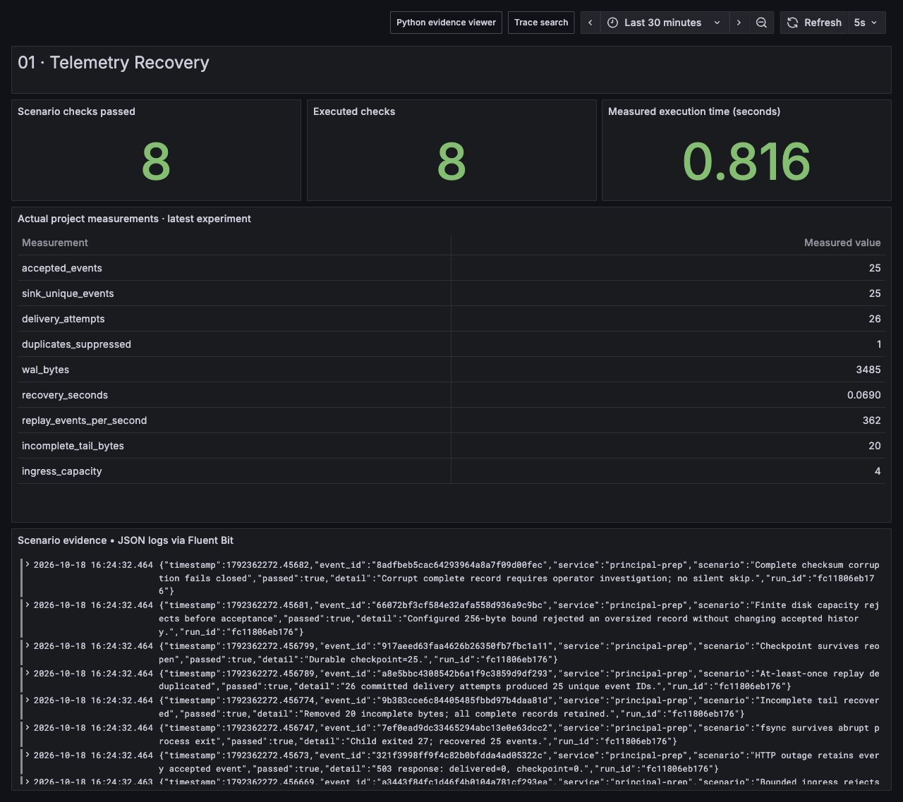

# Telemetry Recovery

Build a durable telemetry sender, make its real HTTP backend unavailable, crash a writer process, and prove which events survive. The demo records evidence on disk and recovers **25 unique events from 26 successful delivery attempts**. The extra attempt demonstrates at-least-once delivery plus an idempotent sink.




## Run and inspect

From the repository root with Python 3.12:

```bash
python run.py --project 01
python -m unittest discover -s tests -p 'test_01*.py' -v
```

The root runner writes a report and state artifacts into its reported output directory. Inspect the append-only `events.jsonl`, atomic `events.checkpoint.json` and `sink.sqlite` paths recorded in the report. Temporary loopback HTTP ports must be allowed by the execution environment. No external service is needed for the local scenario.

## What actually happens

1. A four-slot ingress queue fills; its fifth admission is rejected before any claim of durability.
2. Twenty-four event records are appended, flushed and fsynced into a bounded JSON Lines WAL. A SHA-256 checksum covers every payload.
3. A real HTTP receiver returns 503. Replay stops and the acknowledged position remains zero.
4. A child Python process appends event 25, fsyncs it, and immediately calls `os._exit(27)`. The parent appends an incomplete final fragment to reproduce an interrupted write.
5. Recovery keeps complete validated records and truncates only the incomplete tail. A complete record with an invalid checksum fails closed.
6. The backend recovers. One event commits at the sink without a client checkpoint, reproducing a lost-acknowledgement window.
7. The reopened sender replays all unacknowledged records. A unique SQLite event ID suppresses the replayed duplicate. Each successful delivery advances an atomic, fsynced checkpoint.

The sink also uses SQLite's own WAL mode and `synchronous=FULL`. That database journal is separate from the application's append-only delivery WAL: one protects transactional sink writes, while the other retains events until delivery acknowledgement.

## Principal-level thought process

**Requirements.** An accepted event must survive a sender process exit; retries must not lose acknowledged work; memory and disk must have finite bounds; recovery must expose corruption rather than silently omit data. Define “accepted” as **append and fsync complete**, not arrival in a volatile queue. The client cannot promise preservation of an event rejected before this point.

**Capacity.** Start with `disk_bytes >= incoming_events_per_second × encoded_bytes_per_event × maximum_outage_seconds × headroom`. At 5,000 events/s, 300 encoded bytes/event and a 30-minute outage, the payload estimate is 2.7 GB; with 50% headroom it becomes 4.05 GB, excluding filesystem and checkpoint overhead. Use measured encoded record sizes, including the checksum and JSON envelope. A WAL changes where the queue lives; it does not create infinite capacity.

Recovery capacity must exceed live arrival rate. If incoming rate is `lambda`, replay capacity is `mu`, and backlog is `B`, catch-up time is approximately `B / (mu - lambda)` for `mu > lambda`. With nine million queued events and 15,000/s replay alongside 5,000/s new traffic, catch-up takes about 900 seconds. The demo reports its measured replay duration, but loopback/fsync micro-results are not a production capacity benchmark.

**Alternatives and decision.** A memory queue is simpler but loses buffered events on process exit. A collector disk queue reduces custom code when its accepted-data semantics and supported exporter meet the requirement. Kafka is appropriate when several independent consumers need replay, partitions, or a shared durable handoff; a broker cluster adds replication, retention and partition operations that this single-sender exercise does not require. This implementation makes the write/ack boundary visible with a small local WAL. For production, prefer a mature collector queue or message platform after validating its precise failure semantics.

**Failure boundaries.** Local fsync is not host or availability-zone durability. It depends on OS/filesystem/hardware guarantees and does not survive destruction of the storage device. Checksums detect corruption; they do not repair it. The in-memory record index scales with total retained history. The demo enforces a configured byte cap but deliberately keeps acknowledged records for inspection: there is no segment compaction, so a long-running process eventually reaches its cap even with a healthy backend. A production implementation needs segmented WAL retention/compaction, reserved disk space, a single-writer lock, batch fsync policy, authentication, timeout/backoff/jitter, and a visible policy for full disk. Do not claim exactly-once delivery: event-ID uniqueness supplies idempotent effects at this one sink, while transport remains at-least-once.

**Rollout.** Measure arrival rate and record size first. Size an outage budget, run a canary sender, and alert on queue bytes, oldest unacknowledged age, capacity remaining, replay rate and checkpoint errors. Expand through fault-tested cohorts. Trigger disk-capacity admission control before exhausting the host. Check replay load against ingestion and query SLOs before increasing concurrency.

**Interview narrative.** Begin with the accepted-data boundary and recovery objective, draw the sink-commit/client-ack ambiguity, then derive storage and catch-up capacity. Explain which durability boundary you can prove and which requires replicated storage. Finish with operational signals, overload policy, and why an idempotency key changes duplicate effects but not transport semantics.

## Shared stack connection

The repository's shared stack instruments Python with OpenTelemetry and exports through an OpenTelemetry Collector to Prometheus and Tempo; JSON application logs go through Fluent Bit to Loki, with Grafana as the read surface. The local project uses a tiny HTTP sink so outage and restart assertions run without containers. Its application WAL is an educational implementation, not a claim that OpenTelemetry SDK memory batches are durable. In the deployed stack, inspect the Collector persistent exporter queue and Fluent Bit filesystem buffering separately. Kafka becomes useful if replay must cross independently operated consumers or outlive the sender host; specify replication, retention, producer acknowledgements and consumer offsets before claiming stronger guarantees.

## Code navigation

| File / symbol | Purpose |
|---|---|
| `project.py: DurableWAL` | Checksum append, fsync, incomplete-tail recovery and sequential checkpoint |
| `project.py: DeduplicatingSink` | SQLite transaction and event-ID uniqueness |
| `project.py: receiver`, `post`, `replay` | Real HTTP failure/retry boundary |
| `project.py: run_demo` | Reproducible outage, crash, lost-ack and capacity scenarios |
| `../../tests/test_01_recovery.py` | End-to-end recovery plus independent corruption, capacity and checkpoint assertions |

## Scenarios covered and tested

| Scenario | Evidence |
|---|---|
| Four-slot ingress overload | Fifth item rejected before durable acceptance |
| Real backend 503 | Zero successful replays and checkpoint stays at zero |
| Abrupt process exit after fsync | Child exits 27; event 25 survives reopening |
| Incomplete trailing write | Fragment truncated; all complete records survive |
| Complete checksum corruption | Recovery raises `WALCorruption` and preserves the corrupt complete record |
| Sink commit before sender checkpoint | Twenty-six commits/attempts yield 25 unique events |
| Durable checkpoint restart | Reopen reports acknowledgement position 25 |
| Out-of-order checkpoint | Acknowledging record 2 before 1 raises an error |
| Finite WAL capacity | Oversized append rejected without adding a record |

## Explicit limitations

The demo exercises a process crash and an incomplete-write fixture, not physical power loss, kernel crash, actual `ENOSPC`, disk corruption repair, concurrent producers or a replicated broker. The configured capacity guard is not an injected filesystem-full test. The sink runs locally without TLS/authentication, and dedupe retention is indefinite. A restart before the first durable append still loses volatile ingress. Use the report's observations to defend the implemented boundary, not to imply production hardening.
