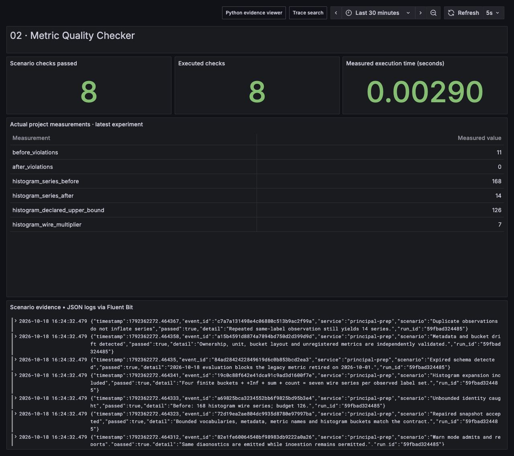

# Metric Quality Checker

Turn a metric policy into executable checks. Validate ownership, units, bounded labels, histogram boundaries and schema retirement dates, then compare **observed series** with the **declared capacity bound**. The supplied before/after fixtures reduce histogram series from **168 to 14**, with a declared maximum of **126**.




## Run and inspect

From the repository root with Python 3.12:

```bash
python run.py --project 02
python -m unittest discover -s tests -p 'test_02*.py' -v

# Before fixture: prints diagnostics and exits 2 in enforce mode.
python projects/02-metric-quality-checker/project.py --mode enforce --as-of 2026-10-18

# Warn mode emits the same diagnostics and exits 0.
python projects/02-metric-quality-checker/project.py --mode warn --as-of 2026-10-18

# Repaired fixture: zero violations, exit 0.
python projects/02-metric-quality-checker/project.py --snapshot projects/02-metric-quality-checker/snapshot-after.json --as-of 2026-10-18
```

The demo writes `before-validation.json`, `warn-validation.json` and `after-validation.json` to its output directory. CLI evaluation defaults to the current date; the reproducible demo explicitly fixes the evaluation date at 2026-10-18.

## What actually happens

The versioned contract lists a metric's type, unit, owner, required naming suffix, finite label vocabularies, budget, histogram boundaries and optional removal deadline. A snapshot supplies actual observations grouped by descriptor. The validator deduplicates identical label combinations, expands each classic histogram into its wire-series count, and returns structured violations. Duplicate descriptors are rejected so a caller cannot split one metric into several descriptors to bypass its budget.

The bad fixture contains 24 distinct user IDs, an altered histogram bucket layout, unknown and missing labels, an invalid route value, wrong units and owner, a negative counter, an expired legacy metric, and an unregistered metric. The corrected fixture uses approved labels and metadata. Warn and enforce modes share identical diagnostics; only the admission decision differs.

## Principal-level thought process

**Requirements.** Preserve aggregatability, bound storage/query load, give each metric an owner, and allow teams to migrate without surprise data loss. Treat a schema change as an API change. Contract review belongs near the instrumented application, while observed-cardinality monitoring belongs at the ingestion/backend boundary; static validation alone cannot establish runtime cardinality.

**Capacity.** If label `i` has `c_i` allowed values, a declared upper bound is `product(c_i) × wire_multiplier`. Two services × three routes × three statuses give 18 label combinations. For a classic histogram with four finite boundaries, include four finite bucket series, the `+Inf` bucket, `_sum`, and `_count`: **seven series per label set**, so 18 × 7 = 126. The repaired fixture observes only two combinations: 2 × 7 = 14. The bad fixture's forbidden user-ID values create 24 observed combinations: 24 × 7 = 168. Observed counts and declared upper bounds answer different questions. A forbidden unbounded label invalidates the declared vocabulary assumption; do not present 126 as a true bound on that bad input.

Translate series into resource planning only with measurement: `ingest_samples_per_second ≈ active_series / scrape_interval_seconds`, then account for churn, retention, replication, index cost and query shape. A 15-second scrape of 126 continuously active series produces about 8.4 samples/s before these factors. Exemplars, native histograms, summaries and backend deduplication have different accounting and require separate contracts.

**Alternatives and decision.** Documentation alone drifts. Central rejection alone can surprise service owners during incidents. SDK wrappers catch common mistakes early but cannot govern all instrumentation libraries. This project uses versioned JSON plus a CLI validator because it is inspectable, works in CI, and can produce the same structured evidence in warn or enforce mode. A production admission service should use the same policy model with explicit performance and availability budgets; the demo validates snapshots rather than intercepting live Prometheus ingestion.

**Failure boundaries.** A sampled snapshot may miss later label churn or rare dimensions. Cardinality is counted across the provided snapshot, without a time window or active-series expiry. Raw request paths can be unbounded even without `user_id`, so the allowed route vocabulary uses templates. Value correctness is limited to finite/nonnegative numeric checks; this validator cannot know whether a plausible request counter reflects reality. Use the independent canary in project 03 for data-path correctness.

**Rollout.** Inventory metrics, assign owners, and measure observed budgets. Start in warn mode, track violation volume and false positives, and set removal deadlines with replacement names. Enforce cheap high-confidence checks for new metrics first; migrate legacy emitters behind canaries. Record rejection counters through an independently protected low-cardinality path. Version bucket changes and avoid mixing incompatible bucket layouts under one metric name.

**Interview narrative.** Start with the cost or correctness failure you are preventing, distinguish observed usage from possible combinations, show histogram multiplication, and discuss label churn. Explain why policy must have migration stages, owners and an escape policy. Describe how you would measure whether rejection improved platform reliability without hiding critical incident data.

## Shared stack connection

The shared path is Python OpenTelemetry → OpenTelemetry Collector → Prometheus/Tempo, with JSON logs → Fluent Bit → Loki and Grafana for inspection. Apply contracts before exporting a metric or in CI and verify active series at Prometheus after collection. A Collector transform can remove dangerous dimensions, but removing labels can merge time series and change semantics; aggregate intentionally. A WAL is not needed for this deterministic, reproducible validation computation. Its input artifacts are immutable fixtures and its reports can be regenerated. Durable transport queues belong in project 01 or the deployed Collector/Fluent Bit storage layer, not inside a policy function. Kafka is unnecessary unless contract events need independent audit/replay consumers.

## Code navigation

| File / symbol | Purpose |
|---|---|
| `contract.json` | Versioned metric definitions, finite vocabularies and removal date |
| `snapshot-before.json` | Real unsafe input fixture |
| `snapshot-after.json` | Repaired bounded input fixture |
| `project.py: validate` | Metadata, label/value, deprecation and cardinality checks |
| `project.py: series_multiplier` | Classic histogram wire-series expansion |
| `project.py: main` | CLI diagnostics and admission exit status |
| `../../tests/test_02_contracts.py` | Before/after, finite numbers, retirement boundary and capacity tests |

## Scenarios covered and tested

| Scenario | Evidence |
|---|---|
| Forbidden user identity | User-ID labels produce explicit policy violations |
| Unregistered/missing labels and unbounded route | Unknown, missing and invalid vocabulary values reported |
| Histogram expansion | Two valid label sets yield 14 wire series, not two |
| Observed budget exceeded | Bad histogram has 168 series over a 126-series budget |
| Declared bound exceeded with few observations | Lowered contract budget fails even while observed count fits |
| Duplicate observations | Same labels do not inflate observed series |
| Duplicate descriptor | Rejected before it can hide a metric's aggregate budget |
| Schema/unit/owner/bucket drift | Separate, inspectable violations |
| Retirement boundary | Legacy schema accepted September 30, rejected October 1 |
| Warn versus enforce | Same evidence, different acceptance decision |
| NaN and negative values | Nonfinite samples and negative counters rejected |
| Clean input | Repaired snapshot has zero violations |

## Explicit limitations

This is a contract validator, not a live metrics firewall or full OpenMetrics parser. Histogram observations in the fixtures use logical sample descriptions and configured bucket boundaries; the validator computes their expected classic histogram wire expansion rather than parsing an actual scrape payload. It does not cover native histograms, exemplars, time-window churn, cross-host external labels, tenant budgets, alert compatibility or arbitrary semantic truth. CI input must come from a trusted complete inventory or be paired with runtime monitoring.
