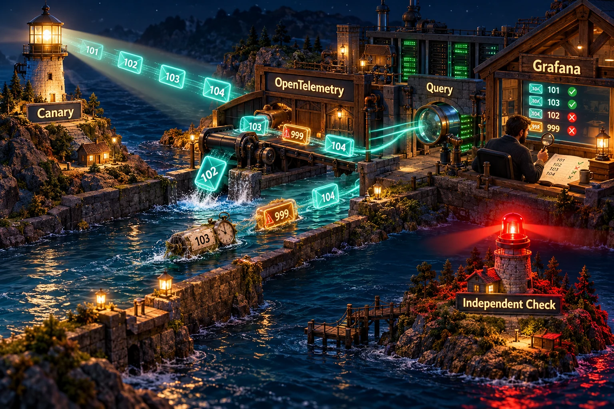
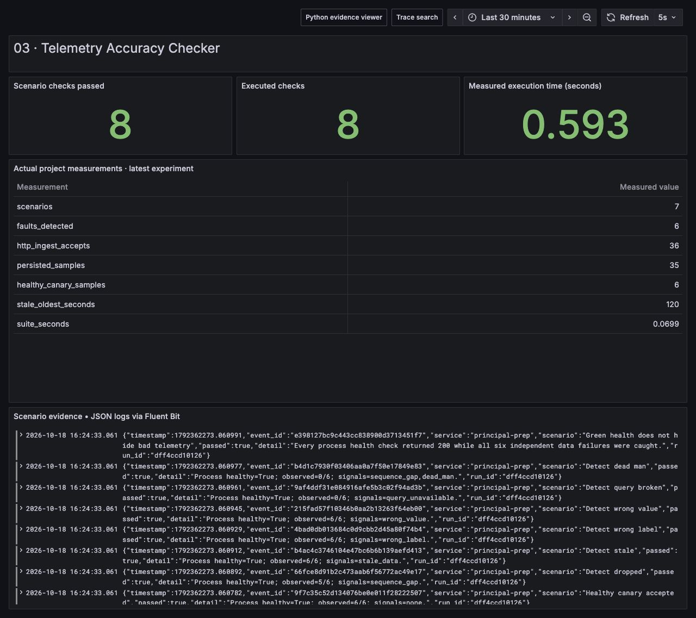

# Telemetry Accuracy Checker

Prove that telemetry can be trusted through the entire collection and query path. An independent canary knows its expected sequence, values, labels and timing. A real HTTP collector persists samples to SQLite; a separate HTTP reader detects **six data failures while every process health check remains green**.





## Run and inspect

From the repository root with Python 3.12:

```bash
python run.py --project 03
python -m unittest discover -s tests -p 'test_03*.py' -v

# Optional transport/query check against the shared Prometheus deployment:
python projects/03-telemetry-accuracy-checker/project.py --prometheus-url http://localhost:19090 --query up
```

The root runner records the persistent `canary.sqlite` and `canary-outcomes.json` paths. The local demo needs temporary loopback HTTP ports, without containers. The optional Prometheus command performs a real instant query and reports its API result; it does not claim the full sequence assertions of the local event-history test.

## What actually happens

1. The emitter defines expected sequences 1–6, values `sequence × 10 + 7`, bounded resource labels and a current timestamp independently of the collector.
2. Six scenarios send six real HTTP POSTs each. A seventh scenario intentionally sends nothing. Each response is counted; “accepted by HTTP” alone is not taken as data correctness.
3. Collection fault modes drop sequence 3, age timestamps by 120 seconds, rewrite a resource label, or alter a value. A separate mode triggers a real SQLite query error. The process health route remains successful.
4. A reader retrieves samples through an HTTP query endpoint and compares them with the original expectations. It verifies sequence completeness/uniqueness, exact values, exact label schema and a 30-second freshness budget. Empty results fail the dead-man test.
5. The demo reports 36 accepted POSTs and 35 stored samples. Healthy data passes; every injected failure is independently detected.

## Principal-level thought process

**Requirements.** Establish completeness, freshness, label integrity, numerical integrity and query availability from the user's read surface. Avoid circular validation: if the checker derives its expected count from the collector's accepted count, dropped data can look correct. The producer's expected sequence and arithmetic function live outside the mutation path, and the query reader compares with that source of truth.

**Capacity and detection budget.** If a canary emits every `T` seconds and pages after `k` consecutive misses, nominal detection delay is roughly `k × T + scheduling_jitter + query_delay`. Choose that delay from the business recovery objective; a fast alert with many false positives is not automatically useful. A production rate of one canary per 10 seconds, across 20 regions and 5 tenant classes, produces 10 events/s and 100 independently bounded identities. If each serialised event is 400 bytes, raw payload is about 4 KB/s before protocol, storage and replication costs. Do not put unbounded sequence IDs into Prometheus labels: store the latest sequence as a value, use log/event history for exact gaps, and bound labels such as region and canary class.

**Alternatives and decision.** Component uptime and `up` reveal reachability, not correctness. Comparing two dashboards that read the same broken store can agree on the same wrong answer. Business-transaction reconciliation is strongest but can be costly and slow. This project starts with a deterministic synthetic signal whose correct answer is known, exercises the HTTP collection and query boundaries, and stores event history for exact gap detection. Add real workload reconciliation once you have a stable control signal. Run at least one checker outside the platform it monitors, and route its failure signal through an independent path.

**Failure boundaries.** A sequence gap may be late arrival rather than permanent loss; production readers need a lateness watermark, reorder tolerance and a final reconciliation window. Clock skew can masquerade as stale or future data; compare producer and ingestion timestamps and monitor time synchronization. The demo deliberately flags samples more than five seconds in the future. An exact synthetic value can pass while a different tenant, region or metric is broken, so choose representative bounded coverage. Canary correctness complements user impact SLOs rather than replacing them.

**Durability.** SQLite WAL mode with full synchronous commits protects the demo's transactional store. The dropped-sample scenario intentionally acknowledges a request without persisting it to prove that external verification catches a broken acceptance promise. That scenario is a fault injection, not recommended receiver behavior. There is no sender delivery WAL in this project: an emitter process crash before HTTP commit can lose an emission and is detected as silence. Combine project 01's delivery WAL with this canary when the requirement is “preserve accepted samples and verify their eventual readability.” Kafka is optional for long-lived replay/multiple readers, but its commit offsets still do not prove downstream query freshness or label correctness.

**Rollout.** First run a shadow canary against one region and one low-risk tenant class. Observe lateness distributions and maintenance behavior before setting paging thresholds. Expand across ingestion, storage and query routes; budget identities to prevent the checker causing cardinality problems. Distinguish query failures, stale data and missing producer signals in alerts. Test the independent alert route and whole-checker silence, then run scheduled failure exercises with measurable detection and recovery objectives.

**Interview narrative.** Open with “the process is healthy but the dashboard is wrong.” Identify the independent source of truth, walk through a silently dropped acknowledged event, and explain why a read-after-write check catches more than a collector heartbeat. Derive detection delay and checker cost, discuss late data versus loss and clock skew, and finish with independent alerting and representative coverage.

## Shared stack connection

The shared deployment sends Python OpenTelemetry to the Collector and then Prometheus/Tempo. JSON logs travel through Fluent Bit to Loki, and Grafana queries the backends. The local HTTP-to-SQLite path makes corruption deterministic and runnable with the standard library. For the deployed extension, emit the arithmetic value as an OpenTelemetry gauge, the latest sequence as a numeric value, and structured canary events through Fluent Bit. Query Prometheus for the latest signal and Loki for sequence history, then verify Grafana uses equivalent expressions and freshness semantics. A Prometheus scrape may miss intermediate gauge updates; exact per-emission gap claims require retained event history, not a gauge-only query.

## Code navigation

| File / symbol | Purpose |
|---|---|
| `project.py: CanaryStore` | SQLite persistence, deterministic collection mutations and SQL fault |
| `project.py: start_pipeline` | Real HTTP ingest, health and query endpoints |
| `project.py: inspect_samples` | Independent sequences, values, label schema and freshness checks |
| `project.py: inspect_query` | Fail-closed query transport handling |
| `project.py: query_prometheus` | Optional actual Prometheus instant-query adapter |
| `project.py: run_demo` | Healthy control and six fault scenarios |
| `../../tests/test_03_accuracy.py` | End-to-end injection plus empty, future-time, duplicate and integrity tests |

## Scenarios covered and tested

| Scenario | Expected observation |
|---|---|
| Healthy path | Six stored samples pass every invariant |
| Collector drops sequence 3 after accepting | Five samples, missing `[3]`, sequence-gap failure |
| Stored timestamp aged 120 seconds | Freshness failure despite process health |
| Wrong region label | Label-integrity failure at sequence 2 |
| Wrong arithmetic value | Numerical-integrity failure at sequence 2 |
| Broken query SQL | HTTP 503 becomes query-unavailable failure |
| Absent producer | Empty result fails dead-man and completeness checks |
| Future timestamp | More than five seconds ahead fails freshness |
| Duplicate sequence | Duplicate sequence fails completeness/uniqueness |
| Green process during every fault | All health routes return 200 while all six faults are detected |

## Explicit limitations

The demo evaluates one emitted batch per scenario and uses a single local clock. It is not a continuous scheduler, real multi-region probe, deployed Grafana query screenshot, Prometheus scrape-loss test or alert delivery system. It does not implement reordering grace windows, independent checker dead-man paging, TLS/authentication, retention cleanup or clock synchronization. The optional Prometheus query adapter proves only query API reachability/success. The report distinguishes HTTP acceptance from storage evidence so its intentionally broken collector cannot appear reliable.
