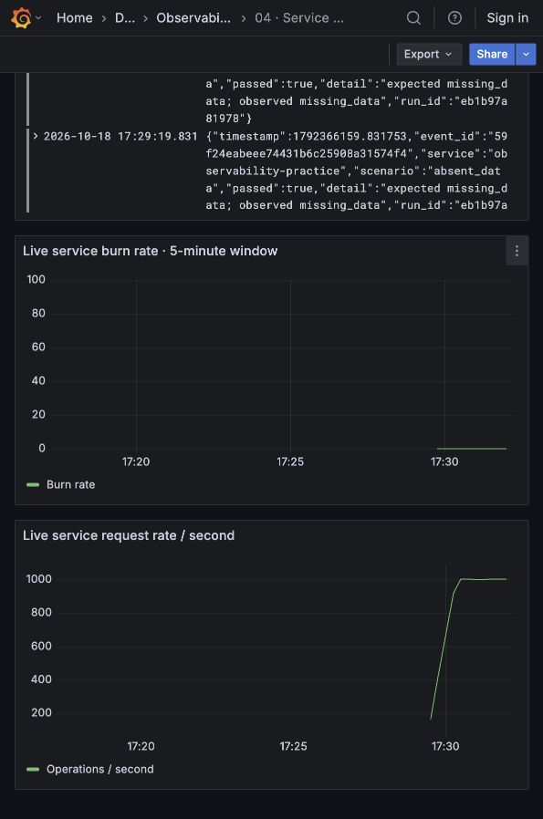
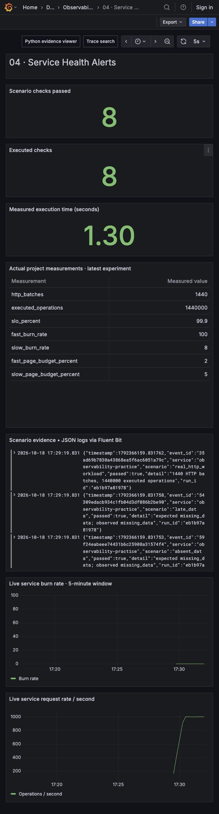

# Service Health Alerts



Turn customer outcomes into alerts that distinguish a short error spike, an incident that spends the error budget quickly, slow degradation, recovery, and missing telemetry.




## Run it

Use Python 3.12. Run commands from the repository root; the deterministic project uses the standard library. Installing the root requirements adds OpenTelemetry exports for the shared Fluent Bit → Loki, OpenTelemetry → Collector → Prometheus/Tempo, and Grafana stack.

```bash
python3.12 -m venv .venv
.venv/bin/pip install -r requirements.txt
.venv/bin/python run.py --project 04
.venv/bin/python -m unittest discover -s tests -p 'test_04*.py' -v
.venv/bin/python run.py --serve
```

Open `http://127.0.0.1:18000` for measured checks. Read the latest run ID from `artifacts/04/latest.json`, then open `artifacts/04/<run-id>/window-evaluations.json` and `events.json` for every input and decision. Actual output from a verified run: **8/8 scenario checks**, **1,440 HTTP batches**, **1,440,000 executed operations**, sustained-failure 1h burn **100×**, slow-burn 6h burn **8×**. These counts describe Python operations inside batches, not 1.44 million HTTP requests.

## What happens

A threaded service executes successful and deliberately failed operations for every HTTP batch. The client takes the returned measured counters and attaches controlled event timestamps. Each of four scenarios covers 360 logical minutes without waiting six hours. The evaluator calculates bad/total over 5m, 30m, 1h, and 6h windows. A recent sample with zero operations means `no_traffic`; an absent or stale sample means `missing_data`.

The fast pair requires both 1h and 5m burn above 14.4. The slower pair requires both 6h and 30m burn above 6. Recovery must clear the corresponding short window; clearing only 5m can leave the 30m pair firing. A telemetry freshness condition prevents a stale series from becoming a reliability success.

The Python evaluator uses exact bucket sums in `(now-window, now]`. Prometheus uses extrapolated counter `rate()` and its own scrape/evaluation timing. These are related policies with different boundary arithmetic; the project does not claim numerical identity between them.

The clock policy accepts sample ages from 0 through 120 seconds, inclusive. Future timestamps are invalid: Python excludes them, the Prometheus burn rule suppresses paging on them, and the telemetry rule raises a ticket. This deliberately strict demonstration allows zero positive clock skew. A production tolerance must be an explicit policy, tested at both boundaries, with clock synchronization monitored independently.

## Design reasoning

Start with the customer promise: a 99.9% successful-operation objective over 30 days. Define the denominator and exclude neither errors nor outages merely because a component is unhealthy. In this example a batch operation, rather than a batch HTTP request, is the SLI event. A real product must explicitly choose its event semantics, latency cutoff, and retry treatment.

The operational question is how much budget an incident may spend before someone should respond. Burn rate is `bad_fraction / (1 - SLO)`. Budget fraction consumed is `burn × window_hours / 720`. A burn of 14.4 over 1h consumes 2% of a 30-day budget; burn 6 over 6h consumes 5%. Pairing each long window with a short one improves reset behavior. The choice follows [Google's SRE alerting guidance](https://sre.google/workbook/alerting-on-slos/).

Evaluate the policy with detection, precision, reset time, and operator cost. Before rolling it out, replay real incidents, identify which user journeys were harmed, and check whether low traffic makes one error disproportionately expensive. A synthetic journey can supplement sparse traffic, but it should remain a separate SLI.

## Capacity and durability decisions

The deterministic run has `4 × 360 × 1,000 = 1,440,000` operations and 1,440 HTTP requests. A streaming implementation can maintain ring buffers of counters instead of scanning every event: for four window sizes, 60-second buckets, and a 6h maximum, retain 360 counter pairs per service. At 16 bytes per pair that is 5,760 raw bytes before object/index overhead. Query capacity depends on service cardinality and recording-rule intervals, not just ingestion throughput.

Prometheus owns its TSDB write-ahead log (WAL). The shared Collector has a persistent exporter queue, and Fluent Bit has filesystem chunks plus a persisted tail offset database. These mechanisms protect different acknowledgement boundaries; none establishes end-to-end exactly-once delivery. An evaluator that recomputes from durable counters does not need a second event WAL. A durable incident state/outbox becomes appropriate if this service itself takes responsibility for notification delivery. Kafka is unnecessary for these local alert calculations; introduce it only for independently replayable consumer pipelines with a measured retention requirement.

## Real-time Prometheus source

The optional source below emits counters on actual wall time. It deliberately runs separately from the accelerated scenario replay, so replayed hours cannot be mistaken for wall-clock rates.

```bash
.venv/bin/python projects/04-service-health-alerts/live.py --port 8084 --bad-per-batch 20
curl -s http://127.0.0.1:8084/metrics
curl -s 'http://127.0.0.1:8084/scenario?bad=0'
```

Add a Prometheus scrape target for `127.0.0.1:8084` when Prometheus runs on the same host. A containerized Prometheus needs a reachable host address and an explicit binding/network decision; the helper intentionally binds loopback. It executes 1,000 operations each second. Twenty bad operations per batch produce a 20× burn once scrape windows have enough samples. This helper does not compress time: wait for actual evaluation windows, or use the rule fixtures.

The shared Docker Compose stack runs this source as `live-sli`, binds it on the container network with `--host 0.0.0.0`, and lets Prometheus scrape `live-sli:8084`. The CLI defaults to `--host 127.0.0.1` for standalone use. Both CLI parsing and the callable server validate the initial bad-operation count before any workload starts.

Validate the supplied rules using [Prometheus's documented rule-test format](https://prometheus.io/docs/prometheus/latest/configuration/unit_testing_rules/):

```bash
cd projects/04-service-health-alerts
promtool check rules prometheus-rules.yml
promtool test rules prometheus-rules.test.yml
```

The supplied rule fixtures exercise sustained 2% errors, absent telemetry, and invalid future timestamps. Python tests additionally cover a short spike, slow burn, recovery, no traffic, stale data, future samples, and invalid counters. The accelerated demo verifies rule *intent*; only the wall-clock source is suitable for live rate evaluation.

## Scenarios and boundaries

| Scenario | Evidence and expected decision |
| --- | --- |
| One-minute 20% spike | Fast short window is high but long window is below threshold; no page |
| Thirty-minute 20% failure | Both fast windows exceed threshold; page |
| Six-hour 0.8% degradation | 8× burn; slower pair pages |
| Recovered for forty minutes | Both short windows clear; no active page |
| Fresh zero-operation sample | Explicit no-traffic state |
| Absent or ten-minute-old samples | Explicit missing-data state |
| Future timestamp | Cannot conceal missing current data |
| Invalid bad/total counts | Reject invalid input |

The policy assumes accurate event counters and sufficiently synchronized event times. The evaluator does not implement Alertmanager deduplication, notification routing, maintenance silences, long-term SLO accounting, or production HA. Per-request latency SLOs need a distinct bad-event definition, not reuse of the availability numerator. The sample tokens and HTTP helpers are for local use.

## Rollout and walkthrough

First publish recording rules and compare them with the existing alert stream. Review historic incidents and low-traffic services, then route initial alerts to a non-paging destination. Enable paging for one owner and one critical journey, watch time to detection and reset, and roll back routing if evidence quality fails. Keep freshness alerts owned by the telemetry platform and user-outcome pages owned by the service team.

**Walkthrough.** Follow this sequence: **define a customer event → quantify acceptable budget spend → choose windows → reproduce failure and recovery → separate data loss from reliability → establish accountable rollout and rollback**. Explain why a ten-minute recovery can still leave the slower pair firing, and what operating response that warrants.
