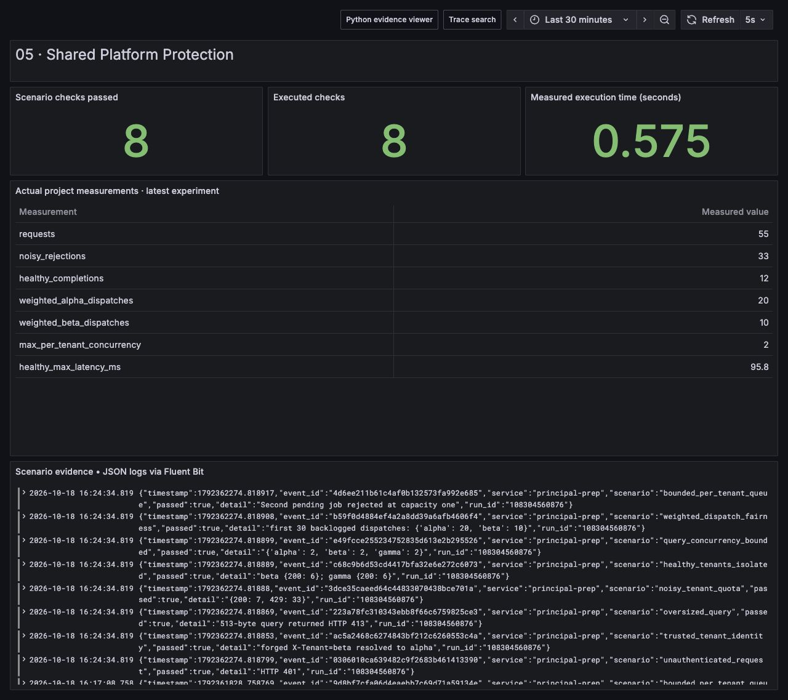

# Shared Platform Protection

Keep one tenant's burst from consuming everyone else's query capacity. This project runs an actual authenticated HTTP gateway with tenant quotas, bounded pending work, query concurrency limits, and weighted dispatch.




## Run it

Python 3.12 and the standard library are enough for this project. Use the root dependencies and shared stack for OpenTelemetry, Fluent Bit, and Grafana.

```bash
python3.12 -m venv .venv
.venv/bin/pip install -r requirements.txt
.venv/bin/python run.py --project 05
.venv/bin/python -m unittest discover -s tests -p 'test_05*.py' -v
.venv/bin/python run.py --serve
```

Commands run from the repository root. The runner starts a temporary loopback gateway, sends real concurrent HTTP requests, saves evidence, and closes every worker. The evidence viewer is `http://127.0.0.1:18000`. Read `artifacts/05/latest.json` for the run ID and `artifacts/05/<run-id>/gateway-results.json` for request status, trusted tenant identity, dispatch order, and maximum active queries.

A verified run passed **8/8 checks**: the noisy tenant received **33 quota rejections**, both healthy tenants completed **all 12 requests**, and continuously backlogged weights 2:1 yielded **20:10 dispatches**. Latency is measured on each run and is not a production benchmark.

## Request journey

The handler looks up a fixture bearer token in a server-owned identity map. `X-Tenant` is deliberately untrusted. It bounds payload and query bytes and rejects an excessive work estimate. A token bucket then admits a bounded burst for that identity. Accepted work enters that tenant's own bounded queue. Workers select queues in weighted round-robin order while respecting per-tenant active-query limits.

The alpha fixture has burst capacity eight, concurrency two, and weight two; beta and gamma each have burst capacity twenty, concurrency two, and weight one. Demo refill is zero to make burst exhaustion reproducible. `Policy.refill_per_second` supports a measured refill rate using monotonic elapsed time. One forged-header request spends an alpha token, leaving seven accepted noisy requests in the subsequent forty-request burst. The independent fairness experiment keeps both queues backlogged so weights can be measured without arrival-time ambiguity.

The sample `demo-alpha-token`, `demo-beta-token`, and `demo-gamma-token` values are public local fixtures, not secrets or production authentication. Replace them with verified identity claims from an identity provider before a network deployment.

## Thought process for a principal interview

Start by naming the unit of isolation. Here it is the authenticated tenant, not a caller-supplied header, an IP address, or an individual request. Then identify the scarce resources: pending request memory, active worker slots, query CPU time, and storage I/O. A request-count quota alone cannot protect against one expensive query; a concurrency cap alone cannot bound the queue.

I chose per-tenant queues because a global FIFO lets the noisy tenant occupy every waiting position. Weighted round robin expresses a service-share policy and permits unused capacity to be borrowed. The guarantee is a ratio of dispatch opportunities while tenants are backlogged and runnable. It is **not** a ratio of CPU time or bytes scanned; variable query costs require deficit scheduling, resource budgets, cancellation, and query-engine enforcement.

The gateway deliberately bounds query bytes and a fixture work duration rather than pretending to estimate arbitrary SQL cost. The principal-level decision is where a policy becomes enforceable: trusted identity at ingress, admission before expensive work, and runtime cancellation inside the query engine. I would ask which tenants may borrow capacity, how the business sells guaranteed capacity, and how an overloaded control plane remains operable.

## Capacity math and alternatives

With four workers and 20ms query service time, the theoretical compute ceiling is `4 / .020 = 200 queries/s`, before handler, scheduler, network, and interpreter overhead. A concurrency-two tenant cannot use more than `2 / .020 = 100 queries/s` under these assumptions. Little's Law, `L = λ × W`, translates a maximum admitted rate into a queueing target; it does not establish an independent latency guarantee.

Three tenants with 32 pending jobs each bound queued jobs to 96. At 512 query bytes each, raw query bytes would be at most 49,152, plus Python objects, connections, response buffers, and metadata. This implementation does not retain query text in queued jobs. HTTP server threads are separate resources and are not bounded by the scheduler: a production gateway needs connection limits and an event-driven ingress or fixed request-handler pool.

Compare the alternatives explicitly: a global semaphore is cheap but offers no fairness; strict tenant partitions give predictable reservations but strand idle capacity; weighted shared service improves utilization but requires bounded costs to approximate resource fairness. Dedicated capacity is appropriate when contractual isolation or security boundaries outweigh pooling savings.

## WAL, Kafka, and shared telemetry

These queries are read-only and retryable. Persisting a queue WAL would recover stale requests after the caller has gone away and increase complexity without improving the response contract. The gateway therefore keeps pending queries in memory and accepts loss on process restart. If accepted work becomes an asynchronous job with an explicit durable acknowledgement, use a WAL or transactional job store before acknowledging, add idempotency keys, and return a job ID. Kafka fits that asynchronous contract when partition ordering and independent replay are required; it does not by itself schedule interactive query CPU fairly.

The shared runner exports scenario spans and metrics through OpenTelemetry and writes scenario evidence to JSON logs. Fluent Bit forwards those logs with filesystem buffering; Grafana can correlate quota decisions, latency, and failure evidence. Collector exporter persistence and Fluent Bit persistence protect telemetry delivery boundaries, not query completion. Label only a bounded tenant set in metrics; unrestricted customer identifiers belong in carefully governed logs or traces.

## Scenarios and tests

| Scenario | Actual assertion |
| --- | --- |
| Invalid token | Gateway returns HTTP 401 |
| Forged tenant header | Alpha token still resolves to alpha |
| Noisy burst | Alpha token quota causes HTTP 429 while healthy tenants complete |
| Oversized query | 513-byte query returns HTTP 413 before admission |
| Excessive fixture work | Duration above 200ms returns HTTP 400 |
| Active-query limit | Scheduler never dispatches more than two active queries per demo tenant |
| Weighted fairness | First thirty backlogged dispatches have a 20:10 ratio |
| Queue exhaustion | Second pending job is rejected at capacity one |

The tests use real loopback HTTP for identity, quota, input bounds, and HTTP status. Scheduler tests also exercise a blocked tenant while another tenant continues. They do not establish resistance to malicious Internet traffic, distributed quota correctness, actual database cost estimation, or CPU-time fairness.

## Failure boundaries and rollout

The quotas and queue state live in one process. Replicating the gateway multiplies effective tenant capacity unless admission uses a shared authority, leases, or consistent routing. A timed-out request can continue executing; production cancellation must propagate to the query engine. The fixed fixture workload is read-only and has a maximum 200ms duration. No durable completion guarantee is claimed.

Begin with admission in shadow mode and compare requested costs, actual execution time, and the effect on healthy tenants. Introduce per-tenant connection limits, quotas, and queue caps before enforcing differentiated weights. Canary one tenant, publish overload responses and retry guidance, reserve control-plane capacity, and record rejected traffic by reason. Roll back policy values independently from the authentication boundary.

Tell the interview story as: **identify a trusted tenant → enumerate scarce resources → choose measurable admission controls → demonstrate noisy-neighbor isolation → state the fairness unit → discuss replica coordination and business guarantees**. A principal answer explains why 2:1 dispatch does not establish 2:1 CPU fairness.
