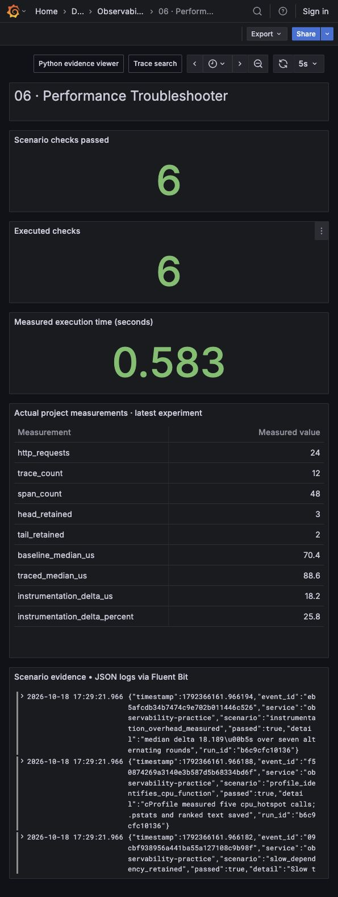

# Performance Troubleshooter

Follow a request through two Python HTTP services, decide which traces to retain, and use a CPU profile to explain work that request timing alone cannot explain.




## Run it

Use Python 3.12. Installing the root requirements enables the official OpenTelemetry SDK. Without those packages, the local demonstration still writes explicitly identified diagnostic span records and evaluates sampling policies; that fallback does not export OTLP.

```bash
python3.12 -m venv .venv
.venv/bin/pip install -r requirements.txt
.venv/bin/python run.py --project 06
.venv/bin/python -m unittest discover -s tests -p 'test_06*.py' -v
.venv/bin/python run.py --serve
```

Run commands from the repository root. Open `http://127.0.0.1:18000` for the evidence viewer. With the shared stack running, set `OTEL_EXPORTER_OTLP_ENDPOINT=http://127.0.0.1:14318` to export through the Collector to Tempo and inspect traces in Grafana. The recorder reuses the root runner's configured SDK provider; it does not replace the global provider.

```bash
OTEL_EXPORTER_OTLP_ENDPOINT=http://127.0.0.1:14318 .venv/bin/python run.py --project 06
```

Read `artifacts/06/latest.json` for the run ID. The run directory contains `traces.json`, `cpu-profile.pstats`, `cpu-profile.txt`, and `overhead.json`.

A verified SDK run passed **6/6 checks**, made **24 HTTP requests** across frontend and dependency services, recorded **48 spans in 12 traces**, and retained **3 traces with the fixture head policy** and **2 with the completed-trace tail policy**. Its tracing overhead was **13.987µs per operation** for this particular microbenchmark; rerun rather than treating that value as a portable SDK cost.

## The request journey

Twelve real frontend requests carry distinct valid W3C `traceparent` values. Each request creates a frontend span, a Python CPU-work span, a dependency-client span, and a dependency-server span. The client injects the active trace context into the outbound HTTP request. The dependency extracts it, producing a child of the client span rather than a disconnected trace.

Request five waits forty milliseconds in its dependency. Request seven returns an injected HTTP 503. Request nine runs a larger Python arithmetic workload. The code saves complete trace records and tests parent IDs, rather than inferring propagation from the fact that two spans happen to exist.

The head comparison retains trace IDs divisible by four: a deterministic 25% fixture decision made without outcome knowledge. The tail comparison retains completed traces containing an error or a frontend duration of at least 25ms. The rare-error and deliberately slow trace IDs are chosen outside the head set to illustrate a missed incident. This deterministic fixture is not an unbiased statistical measurement of a production sampler's error recall.

## Design reasoning

Start with the question an operator is trying to answer. A slow parent request may be waiting on a dependency, spending CPU locally, queueing, or suffering a scheduling delay. Trace spans locate time in the request path. A profile attributes execution within the Python process. Before adding more span names, ask which uncertainty each instrument resolves.

The design keeps distributed identity, trace retention, and profiling separate. A correct trace ID is necessary for causal navigation, but retention determines whether that evidence remains available. Head sampling can reject work early and reduce overhead; tail sampling can use observed latency and errors but needs upstream spans, routing affinity, memory, and a deadline. [OpenTelemetry's sampling documentation](https://opentelemetry.io/docs/concepts/sampling/) explains these distinct decision points.

The SDK path records all demonstration requests before the local completed-trace comparison. The shared Collector exports the actual SDK spans to Tempo; **this project's Python tail policy is an offline comparison, not the Collector's live retention policy**. A production tail sampler requires all spans of one trace to reach the same decision shard and must define behavior for late spans, incomplete traces, restarts, and overflow. The current shared Collector is not claimed to perform that policy.

To explain the CPU hotspot, cProfile runs five actual calls to `cpu_hotspot`, stores a loadable `.pstats` file, and produces a ranked text report. The assertions inspect profiler call counts. The intentionally larger CPU request gives a useful trace clue, but the sampling profile is a separate measured workload; the code does not claim a continuously correlated production profiler.

## Capacity, overhead, and retention math

With request rate `R`, average spans/request `S`, decision wait `W`, and average bytes/span `B`, raw tail-buffer demand is approximately `R × S × W × B`. At 5,000 requests/s, four spans/request, a 10s wait, and 800 bytes/span, raw data alone is 160MB. Add Python/Collector object overhead, queues, skew, and a safety margin before setting memory limits. Hash-based trace routing must remain stable during resharding or traces can split.

`retain_completed_traces` raises `BufferError` if distinct traces exceed its configured trace capacity. This bound demonstrates an explicit failure rather than unbounded distinct-trace growth. It does not bound bytes per trace or implement a live arrival-time eviction queue. Production needs limits on spans/trace, bytes/trace, total bytes, and in-flight export batches.

The overhead experiment alternates baseline and traced order across seven rounds, executes fifty CPU operations per sample, and compares median microseconds. The result includes the SDK/local recording path and span construction used here. It excludes network export completion, steady-state Collector CPU, allocation profiles, and production traffic variability. A negative delta from noise is possible; the check verifies that both costs were measured, not that an overhead threshold was met.

## WAL and Kafka decisions

The SDK's in-process span buffer is not a WAL. A process crash before export can lose spans. The shared Collector's file-backed exporter queue protects accepted export work; it does not durably preserve a tail sampler's in-flight trace assembly. Fluent Bit separately persists scenario logs as filesystem chunks and tracks its tail offset. Make these storage boundaries explicit when analyzing failures.

A custom WAL for every diagnostic span would add sync cost and privacy obligations without automatically recovering a complete distributed trace. Kafka becomes useful when replay and independent durable consumers are actual requirements. Partition by trace ID when one consumer must assemble a complete trace, account for rebalance and late arrivals, and state the retention window. Kafka is optional here because a local sampling comparison and shared Collector persistence meet the learning objective.

## Scenarios and tests

| Scenario | Actual evidence |
| --- | --- |
| Frontend → dependency propagation | Twelve trace IDs with four correctly linked spans each |
| Rare error outside head sample | HTTP 503 trace missing from head set and present in tail set |
| Slow dependency | Deliberate 40ms dependency wait retained by latency policy |
| CPU hotspot | Profiler finds five measured `cpu_hotspot` calls |
| Instrumentation overhead | Seven alternating-round baseline/traced measurements |
| Invalid trace context | Malformed and all-zero trace IDs rejected by fallback parser |
| Trace-buffer exhaustion | Explicit capacity error instead of silently growing distinct traces |

The implementation does not test network partitions in the trace backend, distributed tail-shard failover, missing-span reconstruction, continuous profiling, or GPU profiling. Project 01 covers durable telemetry failure/recovery. Fixed trace IDs are public fixtures for reproducibility and should never be used as real production ID generation.

## Rollout and walkthrough

Instrument one critical request path and verify cross-process parentage before scaling instrumentation. Establish baseline latency, CPU, and allocation costs at several traffic levels. Begin with deterministic sampling and compare retained incident evidence offline. Add latency/error retention only after sizing the assembly buffer and testing late spans, overflow, and shard movement. Keep a rollback path that reduces span volume without breaking propagation.

**Walkthrough.** Follow this sequence: **form a latency hypothesis → follow the request → distinguish waiting from CPU work → measure instrumentation cost → evaluate retention bias → size and protect the evidence pipeline**. Identify what a complete trace still cannot explain and choose the next measurement accordingly.
