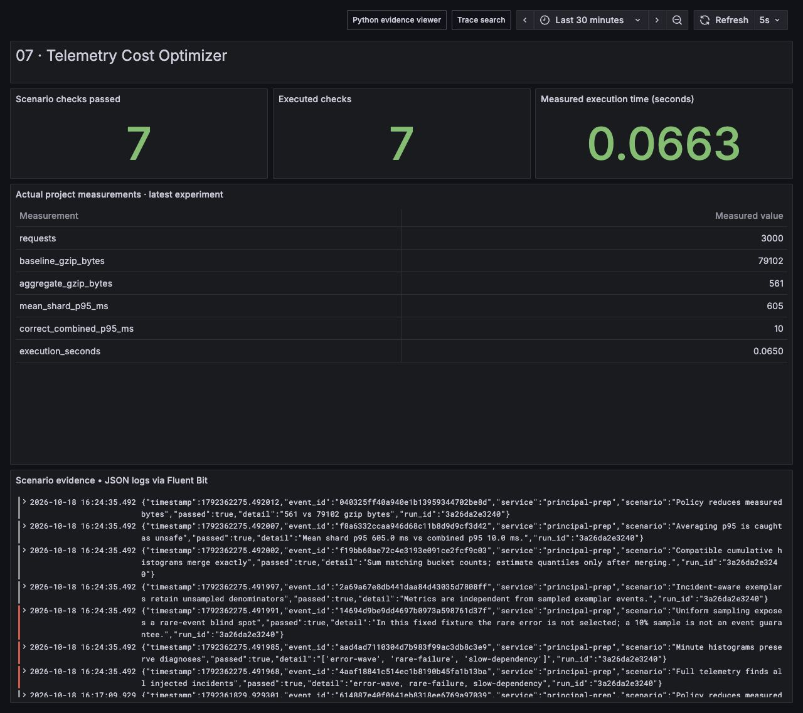

# Telemetry Cost Optimizer

Reduce telemetry only after checking which incident questions the retained data can still answer. This project generates 3,000 requests, transforms the actual records under five policies, writes real gzip files, and replays the same diagnostic rules against each representation.




## Run and inspect

From the repository root after installing `requirements.txt`:

```sh
python run.py --project 07
python -m unittest discover -s tests -p 'test_07*.py' -v
```

`artifacts/07/latest.json` identifies the latest run directory. That directory contains `cost-and-diagnosis.json`, five compressed telemetry representations, and the independent unsampled metrics required by the incident-aware policy. The evidence viewer and shared Grafana dashboard show checks from the actual run. The screenshot is a captured execution report, not a substitute for the raw evidence.

## The principal engineer thought process

Start by asking what decision the telemetry supports. A cheap representation is unacceptable if it removes the only observation of a rare customer failure. Conversely, retaining every debug string forever is unnecessary when counters and compatible latency buckets answer the operational question.

The requirements here are explicit: detect the error wave, the slow dependency and the one rare failure; preserve aggregate error denominators; bound the resolution at which timing can be reconstructed; and make every byte and pricing assumption inspectable. No policy earns credit merely for producing a smaller file.

The five options are:

| Policy | Retains | Main trade-off |
|---|---|---|
| Full | Every original request and repeated debug text | Most detail; expensive per request |
| Uniform 10% | Deterministic hash sample | A rare error can disappear; this fixture demonstrates that outcome |
| Incident-aware | Every error/slow exemplar plus 10% of ordinary exemplars; **independent unsampled metrics** | Biased event population cannot supply an error-rate denominator |
| Minute aggregates | Counts, latency sum and cumulative buckets | Preserves tested rates; loses individual request detail |
| Five-minute aggregates | Same statistics at coarser resolution | Cheaper; wider incident localization and delayed aggregation windows |

The incident-aware cost includes both compressed exemplars and compressed independent metrics. Comparing only exemplars would hide part of its cost. Full JSONL is reported alongside gzip so that compression savings are distinguishable from semantic reduction.

The fixed sample demonstrates a possible sampling blind spot, not a measured universal miss rate. With independent 10% retention, the probability of missing all `n` rare events is `0.9 ** n`. A single rare event has a 90% miss probability under that assumption. This implementation uses stable request hashes for repeatability rather than independent random draws at every replay.

## Quantiles and cost arithmetic

The actual combined sample p95 differs dramatically from the mean of two shard p95 values. A tiny slow shard receives equal weight in an average of quantiles. Instead, sum **compatible cumulative bucket counts** across shards, then compute `histogram_quantile`. Bucket interpolation remains an estimate; it does not recover the exact raw sample p95. The generated report records all three values and verifies bucket equality after merging.

The transparent ingest model is:

```text
30-day compressed GB = measured_compressed_bytes / 1800 seconds
                       * (30 * 24 * 3600 seconds) / 1e9
modeled ingest dollars = compressed GB * assumed dollars per GB
```

The assumed rate is `$0.25/GB`; it is a teaching parameter, not a current vendor quote. The model assumes a constant workload and billing on compressed transmitted bytes. Real billing may use uncompressed bytes, indexed events, active series or queries. Storage retention, replication, query compute, network egress and Kafka disk are deliberately outside this modeled dollar number. The measured byte counts remain useful without accepting the pricing assumptions.

## Scenarios covered and tested

| Scenario | Evidence or assertion |
|---|---|
| Normal traffic | Reproducible lognormal request latencies |
| Error wave | Three minutes containing recurring 503 responses |
| Slow dependency | Three minutes with a 1.25-second latency addition |
| Rare failure | One 500 response in minute 25 |
| Uniform sampling | Demonstrates the fixed rare event being lost |
| Incident-aware sampling | Preserves exemplars while using full metrics for rates |
| Aggregation | Minute histograms preserve all three diagnosis names |
| Downsampling | Five-minute results expose the changed resolution explicitly |
| Quantile mistake | Averaged shard p95 differs from the combined raw p95 |
| Histogram merge | Summed compatible buckets equal a histogram over combined values |
| Byte accounting | Actual serialized and gzip sizes, including independent metrics |
| Invalid policy | Unknown transformation is rejected |

The unit tests also prove that the error ratio computed over incident-aware events is biased. That prevents a misleading demonstration where retaining every error appears to increase the real error rate.

## Stack and durability decision

Python performs the transformations and evaluation. In the full repository, OpenTelemetry exports the project/check spans and metrics; Fluent Bit collects the JSON scenario logs; Grafana displays their outcomes. These local event records are synthetic and are never described as production measurements.

This offline transformation uses immutable fixture input and writes derived artifacts. A second WAL inside a pure replayable transformation would add complexity without protecting a unique input. In a streaming deployment, put the durability boundary before any irreversible drop: Fluent Bit cursor WAL plus filesystem payload buffering, OpenTelemetry persistent queue, and optionally Kafka for retained replay and separate consumers. Kafka is useful when multiple policies must consume the same durable source; it is unnecessary for this bounded local replay. A Kafka acknowledgment also does not guarantee downstream retention of an exemplar.

## Rollout and interview narrative

Shadow the proposed reduction alongside the existing path. Replay historical incident questions and an explicit rare-event set. Set separate acceptance limits for byte reduction, missed diagnoses, temporal resolution and investigative detail. Deploy per tenant or service behind a rollback switch. Keep raw data briefly so the first rollout can be reversed; after retention expires, deleted detail cannot be recreated by a rollback.

In an interview, explain the ordering: define the question, establish ground truth, compare representations, catch a misleading quantile, account for all retained signals, and make the loss explicit. The engineering decision is not “sample 90%.” It is “keep unbiased operational aggregates and choose which detailed questions justify retained events.”

Limitations: the fixture is small, detector rules are intentionally simple, the pricing model excludes much of a real platform bill, and gzip ratios depend on content. Bucket layouts must match before merging; the code demonstrates compatible layouts, not a schema migration across incompatible histograms.
