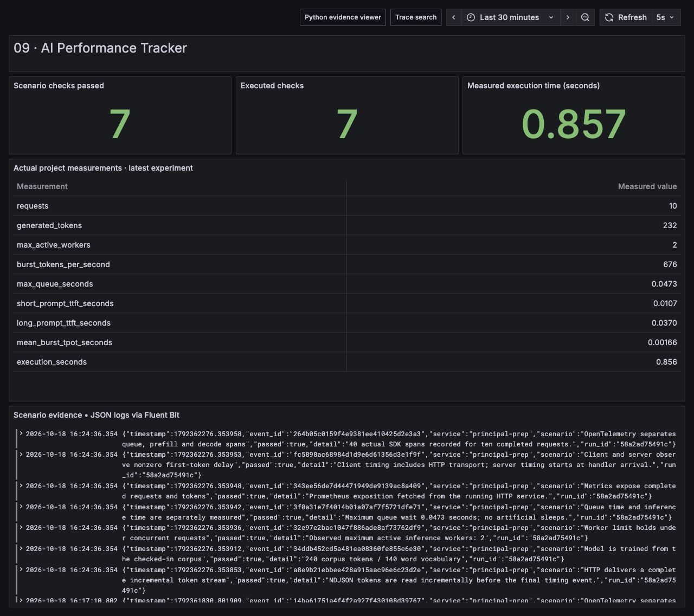

# AI Performance Tracker

Serve a small autoregressive language model over streaming HTTP and measure what a caller experiences: queue delay, time to first token, time between output tokens and completed output throughput. The default is a real **CPU trigram model trained from the checked-in corpus**, so the whole experiment runs without model downloads or GPU access.




## Run and inspect

```sh
python run.py --project 09
python -m unittest discover -s tests -p 'test_09*.py' -v
```

The latest `artifacts/09/latest.json` points to `request-results.json`, `inference.prom` and `inference-spans.json`. Requests actually traverse loopback HTTP. Both server and client measure with a monotonic clock. Durations are machine-specific and are regenerated each run. No fixed latency is reported as a measured result.

Keep a service running for manual requests:

```sh
python projects/09-ai-performance-tracker/project.py --serve --port 8090 --workers 2
```

In another terminal:

```sh
curl -N http://127.0.0.1:8090/generate \
  -H 'Content-Type: application/json' \
  -d '{"prompt":"the checkout service","max_tokens":24,"seed":7}'
curl -s http://127.0.0.1:8090/metrics
```

To add a real Ollama model comparison, use an already-running endpoint and installed model:

```sh
INFERENCE_OLLAMA_ENDPOINT=http://127.0.0.1:21434 \
INFERENCE_OLLAMA_MODEL=qwen2.5:0.5b \
python run.py --project 09
```

That makes an actual streaming `/api/generate` call and saves the provider's model token counts and nanosecond timings alongside client-observed TTFT. No model comparison is reported unless the endpoint completed successfully. Ollama JSON chunks are transport events; the adapter does not pretend each chunk is exactly one tokenizer token.

## The principal engineer thought process

First clarify the objective. A high token generation rate is not enough if requests spend seconds waiting before the first useful token. Ask for a latency objective at the expected prompt lengths, output lengths and concurrency. Then separate the waiting time from actual model work and network delivery.

The measured sequence is:

```text
handler arrival -> bounded worker wait -> context processing -> first sampled token
                -> incremental output tokens -> completed response
```

Server TTFT starts at handler arrival and includes its worker queue. Client TTFT starts before the HTTP request and ends at the first parsed token. It additionally includes connection setup, request transfer and local scheduling. TPOT is elapsed time from first to last received token divided by `N - 1`; that avoids charging first-token work again. Completed output throughput is the sum of produced tokens divided by the burst's wall-clock duration.

The workload runs short and long prompts sequentially, then sends eight simultaneous clients through two inference workers. An ingress semaphore additionally limits HTTP handler threads to 16; a full ingress writes a 503 response and closes the socket before parsing another request. A client concurrently sending a POST body can observe a broken pipe or connection reset instead of parsing that status. Treat all of those outcomes as admission rejection and retry only within an explicit client budget. Accepted sockets have a 15-second timeout. The worker semaphore has a 15-second acquisition timeout. The operating system listen backlog and client timeouts form additional boundaries; this implementation does not claim unbounded admission or production queue fairness.

The model uses smoothed trigram probabilities trained from `corpus.txt` and samples one word token at a time. Context processing computes actual context log likelihood; generation repeatedly scores the finite vocabulary. Repeated scoring is an explicit CPU workload amplifier so timing is measurable, not a hidden sleep or a claim to simulate a neural decoder. Seeds reproduce token sequences, while timing varies.

Python's GIL limits parallel CPU execution in these threads. Two active workers demonstrate resource contention and queue instrumentation, not two cores of inference capacity. A process pool, native inference runtime or GPU scheduler would have different scaling. This distinction is part of the interview discussion, not an implementation footnote.

## Observability and capacity choices

Each completed request records four real OpenTelemetry SDK spans: HTTP request, worker queue, prefill and decode. The raw span artifact includes parent IDs, durations and bounded timing attributes. Set `OTEL_EXPORTER_OTLP_ENDPOINT` to the shared OTLP HTTP collector to send those spans to Tempo and Grafana. The standalone endpoint exposes Prometheus request, output-token, active-worker and accumulated timing metrics. The shared repository runner also publishes scenario-check metrics and Fluent Bit JSON outcome logs.

Use separate queue and model measurements before adding compute. Queue growth with stable token spacing suggests admission or capacity pressure. Increasing token spacing at stable queue depth suggests model or resource contention. Long-prompt first-token growth points toward context work. Client/server timing disagreement can expose transport buffering or scheduling. These are hypotheses to test, not automatic causal proof.

No request payload is added as a metric label. Model name and workload class should stay bounded. Never label by prompt, response text, user ID or trace ID. Prompts are stored here only as synthetic test inputs and output examples; production retention needs an explicit data policy.

## Scenarios covered and tested

| Scenario | Evidence or assertion |
|---|---|
| Short prompt | Complete incremental token stream and client/server TTFT |
| Long prompt | Measured context-processing and first-token difference |
| Eight concurrent clients | Measured queue times and aggregate completed output throughput |
| Worker isolation | Observed active count never exceeds the configured limit |
| Ingress saturation | A held HTTP connection exhausts a one-slot ingress; a raw next connection reads the 503 rejection before sending a body |
| Bad request body | JSON list rejected with 400 before streaming headers |
| Invalid seed or token budget | Rejected before HTTP 200; no truncated success stream |
| Repeatability | Same prompt and seed produce the same sampled sequence |
| Metrics | Actual `/metrics` response includes completed requests and tokens |
| Tracing | Ten demo requests produce 40 SDK spans across four operation names |
| Optional real LLM | Actual Ollama stream and provider timing persisted when explicitly enabled |

The demo produces 232 tokens across ten CPU model requests. That is a workload definition; throughput and latency always come from execution. The code intentionally does not assert that a long prompt must be slower in every scheduler run. Tiny measurements fluctuate, and encoding that expectation as a universal performance test would be misleading.

## Durability and streaming decision

Do not insert Kafka or a WAL between individual output tokens just to use a component. Interactive first-token delivery and reliable audit retention have different objectives. The model can regenerate a deterministic test request; delaying every token for durable acknowledgment would change the behavior being measured.

If asynchronous batch inference needs recoverable jobs, persist the accepted job before acknowledging it and use a durable worker queue such as Kafka where partitioning and replay are justified. Carry a request ID for idempotency because an accepted job may be retried. Persist completion independently from token delivery. The repository's Fluent Bit and collector queues protect telemetry; they do not turn an interrupted client stream into a completed inference response.

## Rollout and interview narrative

Start with a controlled workload matrix of prompt length, output length and concurrency. Warm the model separately from steady-state measurements, repeat runs and compare distributions rather than one mean. Establish queue/TTFT/TPOT budgets, then load until the objectives fail. Report useful completed tokens and rejection rate alongside utilization. For a neural model, add batch sizes, KV-cache pressure, model placement, device memory and GPU saturation; the CPU trigram result cannot establish any of those properties.

In an interview, use the eight-client burst to explain why a service can report fast token generation yet poor response time. Show a request's queue, prefill and decode spans, compare its client timing, and state exactly which measurements require a real GPU deployment.

Limitations: the small corpus yields unhelpful language, word tokens differ from LLM tokenizer tokens, vocabulary scoring is CPU-bound and intentionally repeated, the HTTP protocol is NDJSON rather than a production inference API, timing lacks statistical power for capacity planning, and the default run makes no claim about neural accuracy, GPU utilization or production throughput.
