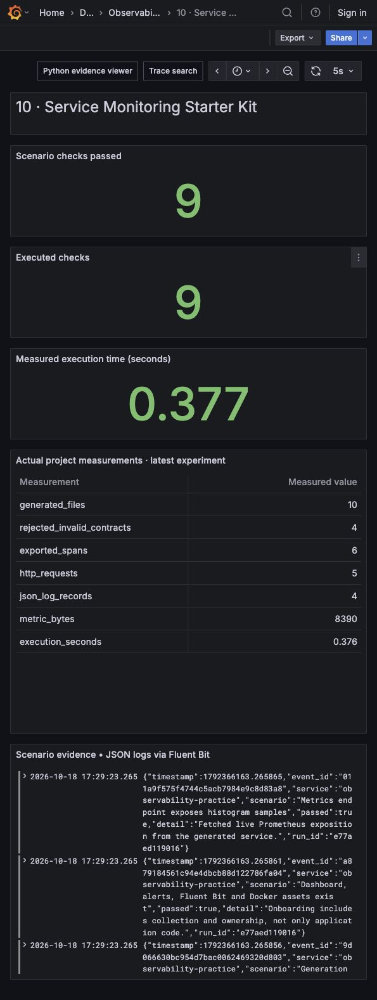

# Service Monitoring Starter Kit

Generate a runnable Python service from an ownership and telemetry contract, then prove that its health endpoint, metrics, traces and failure signals work together. The generated project includes application source, pinned dependencies, Dockerfile, Grafana dashboard, Prometheus alerts, scrape configuration and Fluent Bit configuration.




## Run and inspect

```sh
python run.py --project 10
python -m unittest discover -s tests -p 'test_10*.py' -v
```

The demo generates the service, launches a Python subprocess, calls it through real HTTP and collects live Prometheus samples and actual OpenTelemetry SDK spans. The latest `artifacts/10/latest.json` identifies the directory containing `generated-service/`, `responses.json`, `service.prom`, `service-traces.jsonl` and `service.jsonl`.

Generate a service in a destination of your choice:

```sh
python projects/10-service-monitoring-starter-kit/project.py \
  --contract projects/10-service-monitoring-starter-kit/service-contract.json \
  --destination work/my-service
cd work/my-service
python -m venv .venv
. .venv/bin/activate
pip install -r requirements.txt
python app.py 2>service.jsonl
```

In another terminal, call `/health`, `/work`, `/work?fail=1` and `/metrics` on port 8080. `SERVICE_PORT`, `SERVICE_HOST` and `SERVICE_TRACE_FILE` configure deployment; the default bind is loopback. Docker sets the bind to `0.0.0.0`. To send spans to the shared collector, set `OTEL_EXPORTER_OTLP_ENDPOINT=http://127.0.0.1:4318` for a host process, or the appropriate Compose service URL inside a container. This uses the real OTLP HTTP exporter, not a generated tracing stub.

## Design reasoning

Start with the friction in onboarding a service: teams can copy an HTTP example, but ownership, signal conventions, dashboards, collection and error behavior often arrive separately. A useful platform template makes the operational contract concrete and testable while keeping the inputs small.

This contract requires a service name, owner, contact, bounded static routes, bounded metric labels, an availability target and a latency target. Validation happens before writing any files. Invalid ownership, a `request_id` metric label, a dynamic `/users/{id}` path and an impossible 100% target are rejected. A typo should fail early instead of silently creating an unowned or expensive service.

The generator's output is deterministic. A SHA-256 manifest covers every generated file. Identical contracts produce identical bytes, making review and future upgrades inspectable. In a real template platform, preserve the contract version, offer a migration diff, and avoid overwriting service-owned business logic on upgrade. This generator intentionally writes a fresh service skeleton; use an empty destination or review changes before regenerating over edits.

The generated service emits a server span and a work child span, a JSON request log with the same trace ID, a request counter and a duration histogram. W3C `traceparent` is extracted from the incoming HTTP headers. The verification asserts that the exported server span uses the caller's trace ID and parent span ID. A failure returns 500, increments the matching metric and marks its span `ERROR`; a green `/health` alone would not prove that behavior.

## Bounded telemetry and objectives

Metrics use `service`, normalized `route`, `method` and `status_code`. Unknown URL paths collapse to one `__unmatched__` value. Customer-specific paths never become metric labels. Metric cardinality is approximately:

```text
service_count * route_count * method_count * status_count * histogram_series_per_label_set
```

The contract permits at most ten static routes. Real services may need router templates; those should be explicitly normalized and validated, not copied from raw paths.

Histogram finite buckets include the exact latency target plus 2× and 4× that target as well as the standard small buckets. The test generates a 60-second target and records a 70-second observation to verify that it remains visible above the target instead of saturating a 2.5-second finite range. A bucket quantile remains an interpolation estimate; exact target compliance can use the target bucket divided by the count.

The generated error alert expresses a simple fast-burn threshold: error ratio greater than `14.4 * (1 - availability_target)` for two minutes. It is an onboarding example, **not** a complete production multiwindow paging policy. The denominator clamp handles no/very-low traffic numerically but does not define low-traffic paging behavior. Project 04 develops those decisions. The p95 latency alert is a separate starter symptom threshold; availability and latency budgets should be owned and reviewed separately.

## WAL and collection ownership

The generated `fluent-bit.conf` tails `/var/log/service/*.jsonl`, persists a SQLite cursor DB using `DB.journal_mode WAL`, buffers payload chunks under a persistent filesystem storage directory, and sends JSON records to the repository's Loki service at `loki:3100`. Mount the generated `parsers.conf` alongside `fluent-bit.conf` under `/fluent-bit/etc`. Its `job=generated-service` and static `service` labels identify the stream in Grafana. These mechanisms protect different state:

| State | Durable mechanism | What it does not guarantee |
|---|---|---|
| Tail cursor transactions | SQLite WAL | Does not itself retain unsent log payloads |
| Queued payloads | Fluent Bit filesystem chunks | Finite disk can fill; upstream log rotation still matters |
| Collector outbound telemetry | Shared OpenTelemetry persistent queue | Does not prove backend query correctness |

Persist both the cursor DB and payload directory, mount application logs for the collector, and use the repository's live stack to exercise the transport. The output has a finite 64 MB queue cap; reaching it can discard older chunks, so this configuration does not promise lossless retention during an unlimited outage. The generated configuration alone is not described as a tested outage/recovery experiment; project 01 and the repository's transport checks cover durability behavior. Kafka is optional when the platform needs durable replay or separately paced consumers. It is unnecessary between one local service and a single collector for this onboarding demonstration.

Application trace JSONL is a local verification sink. It does not claim crash-consistent delivery; production transport uses the OTLP exporter and collector queue. The application does not synchronously fsync every request to make a broader durability promise than the implemented path supports.

## Scenarios covered and tested

| Scenario | Verified result |
|---|---|
| Complete valid contract | Generates runnable assets with ownership |
| Missing owner | Validation rejects before file creation |
| Unbounded metric label | Validation rejects `request_id` |
| Dynamic raw route | Validation rejects the contract |
| Invalid objectives | Rejects 1.0 availability and Boolean targets |
| Repeat generation | Every generated file hash matches |
| HTTP health/work | Live subprocess returns real 200 responses |
| W3C propagation | Incoming trace and parent IDs match exported server span |
| Work failure | Live 500, error metric and `ERROR` span appear together |
| JSON log correlation | Parsed success and failure log records match the actual response trace IDs, statuses and exported server spans |
| Unknown request path | Returns 404 with one `__unmatched__` metric label |
| Metrics | Live counter and histogram exposition is fetched |
| Large latency target | 70-second observation is placed above a 60-second objective |
| Operational assets | Grafana, alert, Fluent Bit and Docker files exist and are reviewable |

The end-to-end run starts and stops the generated service automatically. It does not leave a background service behind. The manual `app.py` command keeps the generated service running until you stop it.

## Rollout and walkthrough

Treat the starter as a small platform product. Measure time to the first useful dashboard, percentage of services with real owners, invalid contracts caught before deployment, and drift after onboarding. Pilot with one team, capture the first failure case and upgrade the generator with a versioned migration. Enforce low-friction required metadata first; add policies when their operational cost is understood.

Alternatives include a large framework, copy-and-paste documentation, or a central sidecar that adds every signal. A framework can constrain service choices; documentation drifts; a sidecar cannot infer business ownership or internal spans. This generator supplies a thin executable contract and lets the shared collection stack handle transport. Its main trade-off is ownership of generated code and future migrations.

**Walkthrough.** Follow a service from owner contract to first failing request. Show the rejected cardinality mistake, the exact trace-context assertion, and the target-aware histogram test. Explain why template adoption, operational consistency and upgrade safety matter as much as generating files.

Limitations: this is a small stdlib HTTP server rather than a production application framework; it has no authentication, TLS, autoscaling or application-specific SLO; labels are intentionally fixed; generation can overwrite an existing destination; the included paging rule needs a production multiwindow design; and deployment of the generated dashboard/alerts requires the documented Grafana/Prometheus integration.
